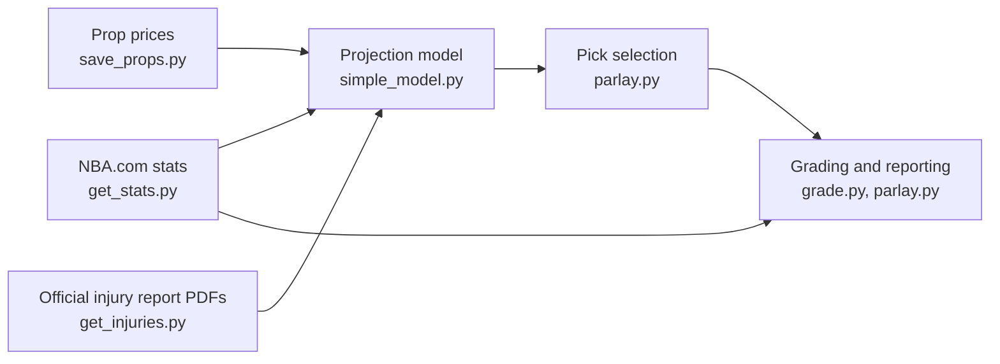

# NBA Analytics Data Pipeline

An automated Python pipeline that collects NBA player statistics, sportsbook
prop prices and the league's official injury reports every day, combines them
into player projections, and grades every projection against real results.

It runs unattended on macOS (scheduled with `launchd`), handles unreliable
third-party data defensively, and keeps API keys out of the source code.

> Research and learning project. Predictions are paper-tracked only.

## How it works



Every day at a scheduled time, `daily_run.sh` runs the whole chain:

| Step | Script | What it does |
| --- | --- | --- |
| 1 | `get_stats.py` | Downloads every player's game-by-game box scores (3 seasons) from NBA.com via `nba_api` |
| 2 | `save_props.py` | Saves the day's player prop lines from several sportsbooks (PropLine API, with The Odds API as a fallback) |
| 3 | `get_injuries.py` | Finds the newest official NBA injury report (published as a PDF every 15 minutes) and parses it into a table |
| 4 | `simple_model.py` | Projects each player's stat as expected minutes × per-minute rate, adjusted for injured teammates, then blends it with the market consensus |
| 5 | `grade.py` | Grades past projections against actual results (hit rate, profit/loss, by confidence bucket) |
| 6 | `parlay.py` | Selects the day's highest-confidence picks and tracks a paper bankroll |

## Technical highlights

- **Messy data from four sources.** Player names differ across sites
  ("Jokić" / "Jokic", "Brunson, Jalen", "Jr." suffixes), so every source is
  normalized to one key before joining.
- **PDF parsing.** The injury report is only published as a PDF; the script
  builds the report URL for each 15-minute slot, walks back until one exists,
  validates the file signature, and extracts structured rows.
- **Fails safely.** Requests have timeouts and retries; missing or stale data
  (no report today, unmatched names, games not yet played) is reported and
  skipped instead of crashing the run or producing silent errors.
- **Point-in-time correctness.** Projections only use data available before
  each game, so grading isn't contaminated by information from the future.
- **Market consensus.** Each sportsbook's price is converted to a no-vig
  probability and compared against the average of the other books.
- **Automated evaluation.** Every projection is logged and later graded, so
  the model is measured on results instead of impressions.

## Security

- **Secrets are not in the code.** API keys are loaded at runtime by
  `config.py` from a local `.env` file (permissions `600`) or from
  environment variables. `.env.example` shows the expected format.
- **`.gitignore`** excludes `.env`, all data files and logs, so no keys or
  personal data are committed.
- **Rate limits are respected.** Requests are paced and retried with backoff,
  and API quotas are reported after every run.

## Setup

```bash
pip3 install nba_api pandas requests nba-injury-report
cp .env.example .env          # then put your own API keys in .env
python3 get_stats.py          # first download takes about a minute
bash setup_daily.sh           # schedule the daily run (macOS)
```

Free API keys: [PropLine](https://prop-line.com) and
[The Odds API](https://the-odds-api.com). NBA.com stats and injury reports
need no key.

## Data sources

- NBA.com stats via [`nba_api`](https://github.com/swar/nba_api)
- [Official NBA injury report](https://official.nba.com/nba-injury-report-2025-26/)
- Sportsbook prices via PropLine / The Odds API

## Roadmap

- Opponent pace and defense adjustments
- Rest and travel (back-to-backs)
- Tuning the injured-teammate adjustment from graded results
